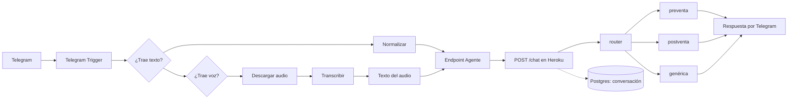

# Ecommerce Router

Proyecto Python 3.12 con LangGraph, FastAPI y Gemini. El agente `router`
clasifica cada mensaje del chat de la tienda en una de tres rutas:

- `preventa`: productos, precios, tallas, stock, promociones y pagos antes de comprar.
- `postventa`: pedidos existentes, reclamos, devoluciones, cambios, garantías y daños.
- `generica`: saludos o preguntas que no corresponden al ecommerce.

La memoria conversacional se conserva por `thread_id`. En la API, `user_id` se
usa como `thread_id`.

## Configuración local

Usa Python 3.12 y crea el entorno virtual:

```powershell
py -3.12 -m venv .venv
.\.venv\Scripts\Activate.ps1
pip install -r requirements.txt
Copy-Item .env.example .env
```

Edita `.env` y completa `GOOGLE_API_KEY` y `DATABASE_URL`. No subas `.env` a GitHub.

## Clave de la API

`/chat` requiere la cabecera `X-API-Key`. Genera una clave aleatoria, por
ejemplo, con:

```powershell
python -c "import secrets; print(secrets.token_urlsafe(32))"
```

En local, guarda el resultado en `.env`:

```text
API_KEY=tu_clave_generada
```

En Heroku, configúrala como Config Var (sin ponerla en el código):

```powershell
heroku config:set API_KEY=TU_CLAVE_GENERADA --app NOMBRE-DE-TU-APP
```

Puedes introducirla en `/docs` mediante el botón **Authorize** (candado) o
enviar `X-API-Key` manualmente en las peticiones a `/chat`.

## Correr el router en local

Desde la raíz del proyecto:

```powershell
python main.py router "¿tienen la polera azul en talla M?"
python main.py router --saltos "mi pedido 4521 llegó roto"
python main.py router --diagrama
```

Puedes cambiar el hilo de memoria con `--thread-id`:

```powershell
python main.py router --thread-id usuario-123 "¿cuánto cuesta el envío?"
```

## Levantar la API

```powershell
uvicorn api.app:app --reload --port 8000
```

La documentación interactiva está en <http://localhost:8000/docs>.

Health check:

```powershell
curl http://localhost:8000/health
```

Ejemplo de chat:

```powershell
curl -X POST http://localhost:8000/chat -H "Content-Type: application/json" -H "X-API-Key: TU_CLAVE" -d '{"user_id":"usuario-123","texto":"¿Tienen la polera azul en talla M?"}'
```

El endpoint `/chat` devuelve `ruta`, `motivo` y `respuesta`. Un body sin
`texto` recibe `422`; si falla el proveedor del modelo, la API responde `502`.

## n8n: la puerta de entrada

### 1) El recorrido

El recorrido de una conversación es:



En resumen: Telegram entra a n8n, el flujo distingue texto y voz, y ambos
caminos terminan en `Endpoint Agente`. Ese nodo llama a `POST /chat` en
Heroku; el router deriva a preventa, postventa o genérica y la respuesta vuelve
a Telegram. La conversación se guarda en Postgres mediante `thread_id`.

### 2) Cómo reproducirlo

1. Importa `n8n/flujo_telegram_agente.json` en n8n.
2. Crea estas tres credenciales:
   - **Telegram API**, con el token del bot.
   - **Header Auth**, con nombre `X-API-Key` y la clave de la API.
   - **Google Gemini**, con la clave del modelo.
3. Cambia la URL del nodo **Endpoint Agente** por la URL de tu API desplegada.
4. Publica el flujo.

### 3) Qué no está en el repositorio

Las credenciales de n8n y la clave de la API no están en el repositorio. Se
solicitan por una vía privada y nunca deben escribirse en commits, prompts ni
archivos públicos.

### 4) Qué pasa cuando falla

- **Audio de voz:** n8n lo transcribe y lo envía como texto al agente.
- **Audio que no se pudo transcribir:** responde `Audio no entendido`.
- **Foto o sticker:** responde `Solo texto o voz`.
- **API caída o clave incorrecta:** responde `Avisar la falla`.
- **Postgres caído:** la API continúa con memoria en RAM y `/health` informa
  `"memoria": "ram"`.

### 5) La memoria y los datos

Postgres guarda los checkpoints de las conversaciones y los reclamos creados
por postventa. Puedes consultar esa información desde la raíz del proyecto:

```powershell
python scripts/ver_memoria.py
python scripts/ver_memoria.py NOMBRE_DEL_HILO
python scripts/ver_reclamos.py
```

La variable `DATABASE_URL` se configura en `.env` para local y como Config Var
en Heroku. Su valor se solicita por una vía privada y no debe publicarse.

## Pruebas

Ejecuta toda la suite:

```powershell
python -m pytest -q
```

Evalúa los 15 casos del router y muestra una tabla con motivos:

```powershell
python scripts/test_router.py
```

## Despliegue en Heroku

El proyecto incluye `Procfile`, `.python-version` y `requirements.txt`.
Después de instalar y autenticar Heroku:

```powershell
heroku login
heroku create NOMBRE-DE-TU-APP
heroku config:set GOOGLE_API_KEY=TU_CLAVE DATABASE_URL=TU_URL_DE_POSTGRES MODELO=gemini-3.5-flash-lite TELEGRAM_TOKEN=TU_TOKEN TELEGRAM_SECRET=TU_SECRETO PUBLIC_URL=https://NOMBRE-DE-TU-APP.herokuapp.com
git push heroku main
heroku open
```

No pongas la clave real en archivos del proyecto ni en commits; usa variables
de configuración de Heroku.

## Conectar Telegram

### 1. Crear y configurar el bot

Habla con `@BotFather` en Telegram, ejecuta `/newbot` y copia el token
entregado en `TELEGRAM_TOKEN`. Elige un valor secreto para `TELEGRAM_SECRET`.

### 2. Configurar Heroku y desplegar

Desde la raíz del proyecto:

```powershell
heroku config:set TELEGRAM_TOKEN=TU_TOKEN TELEGRAM_SECRET=TU_SECRETO --app NOMBRE-DE-TU-APP
git add api/app.py scripts/set_webhook.py scripts/webhook_info.py README.md
git commit -m "conecta Telegram al router"
git push origin main
git push heroku main
```

Si aún no existe el remoto de Heroku, créalo una vez:

```powershell
heroku git:remote -a NOMBRE-DE-TU-APP
```

### 3. Registrar y comprobar el webhook

Configura `PUBLIC_URL` con la URL HTTPS de Heroku en `.env` y ejecuta:

```powershell
python scripts/set_webhook.py
python scripts/webhook_info.py
```

`set_webhook.py` usa `PUBLIC_URL + /telegram` y `TELEGRAM_SECRET`. El segundo
script permite confirmar la URL registrada y revisar `last_error_message` o
los errores pendientes de Telegram.

En PowerShell, `.env` debe contener, por ejemplo:

```powershell
$env:PUBLIC_URL = "https://NOMBRE-DE-TU-APP.herokuapp.com"
```

### 4. Probar el bot y revisar logs

Escribe al bot estos seis mensajes y verifica que cada uno llegue a la ruta
correcta en los logs:

```text
¿tienen la polera azul en talla M?       -> preventa
mi pedido 4521 llegó roto                -> postventa
hola                                      -> generica
¿cuánto cuesta el envío a Valparaíso?    -> preventa
quiero devolver unas zapatillas           -> postventa
¿qué hora es en Tokio?                    -> generica
```

Observa los logs con:

```powershell
heroku logs --tail --app NOMBRE-DE-TU-APP
```

### 5. Si el bot no responde

Revisa que:

1. El webhook apunte a `https://.../telegram`, no a HTTP ni a la raíz `/`.
2. `TELEGRAM_SECRET` sea exactamente igual en Heroku y en el registro del webhook.
3. `TELEGRAM_TOKEN` sea el token correcto entregado por `@BotFather`.
4. `python scripts/webhook_info.py` no muestre `last_error_message`.

### Prueba local opcional

Puedes exponer la API local con Cloudflared:

```powershell
cloudflared tunnel --url http://localhost:8000
```

Usa la URL HTTPS que entregue Cloudflared como `PUBLIC_URL`, ejecuta
`python scripts/set_webhook.py` y luego revisa `python scripts/webhook_info.py`.

## Bruno

La colección está en `bruno/` e incluye `health`, `chat-preventa`,
`chat-postventa` y `chat-generica`. Selecciona el entorno `local` o `heroku`;
ambos usan la variable `baseUrl`, por lo que puedes cambiar entre
`http://localhost:8000` y la URL pública sin editar las peticiones.
